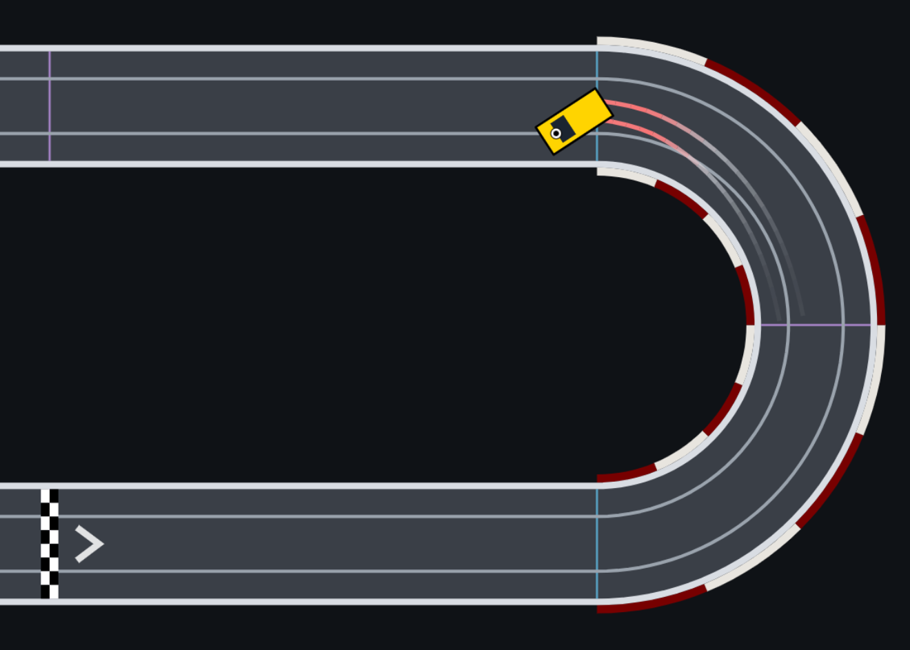

# OpenSlotCars

A slot car racing simulator that runs in your browser, with six circuits, sliding cars and lap timing.



<a href="https://isghe.github.io/openslotcars/" target="_blank" rel="noopener noreferrer">https://isghe.github.io/openslotcars/</a>

Hold `Space`, `Arrow Up` or the **Throttle** button to accelerate; release to brake.
Press `P` or `Esc` to pause, `R` to restart. Choose a track from the **Circuit** menu.
Lap and sector times are saved in your browser for each circuit. **Restart**
keeps them; **Reset…** clears the current circuit's saved times after confirmation.

## Run locally

Requires Node.js 20 or later. No dependencies to install.

```sh
npm start
```

Open <http://127.0.0.1:8080/>.

## Documentation

- [Circuits](docs/CIRCUITS.md): layouts, screenshots and lap lengths.
- [Technical details](TECHNICAL_DETAILS.md): controls, timing, display options, setup, tests and architecture.

## License

[MIT](LICENSE).
