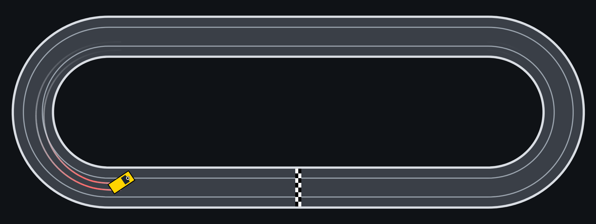
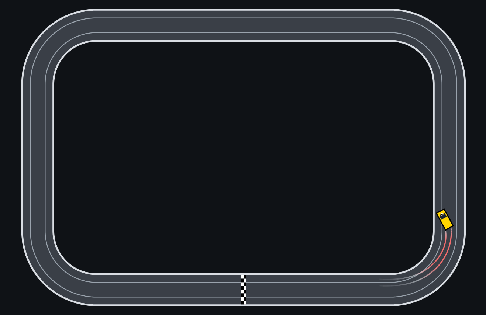
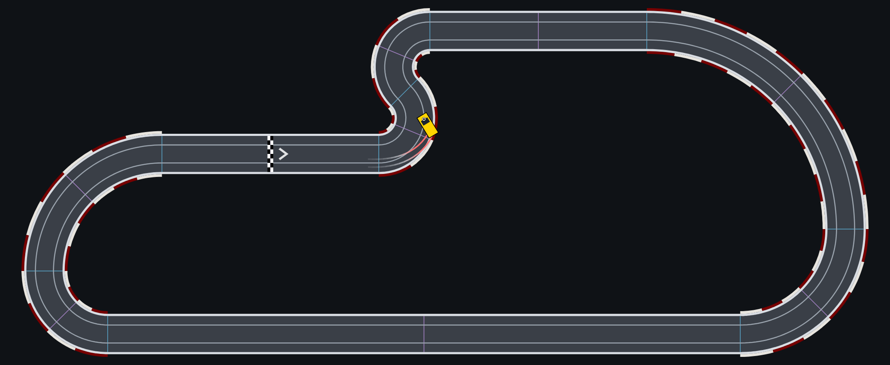
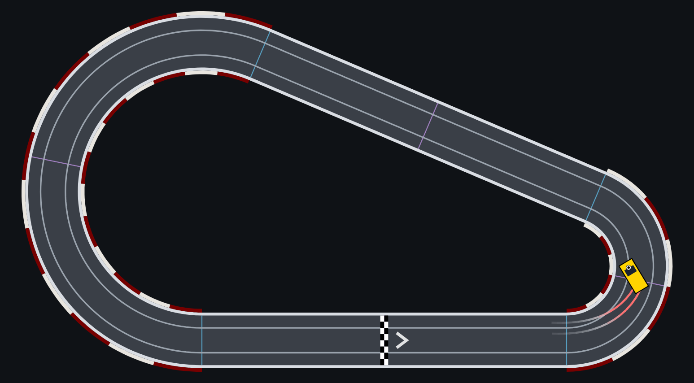
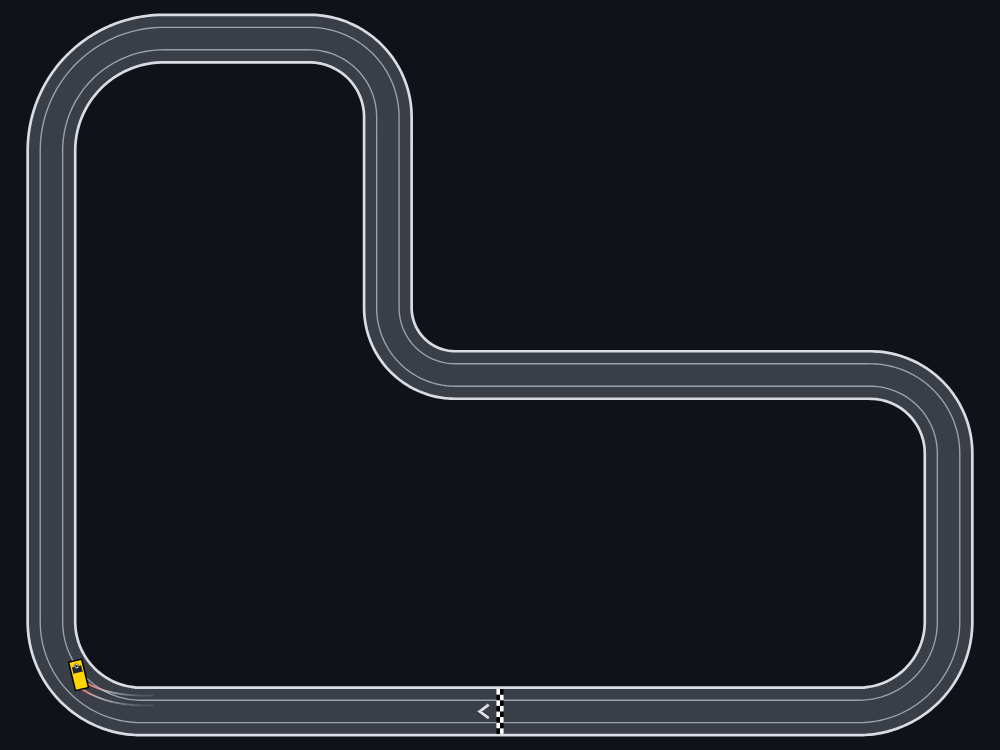
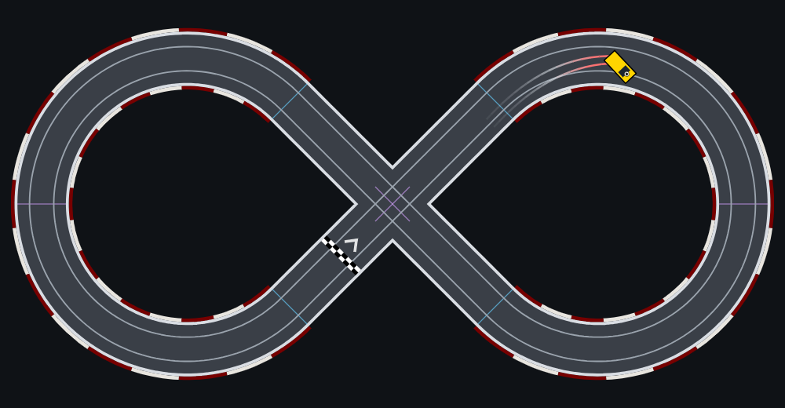

# OpenSlotCars

A slot car racing simulator that runs in your browser. Keep the throttle down through a curve and the tail of the car slides out, leaving tire marks on the track.

## Play it online

**<https://isghe.github.io/openslotcars/>**

Hold `Space` (or the **Throttle** button on a touch screen) to accelerate and release it to brake. Too fast in a curve and the tail slides out; much too fast and the car leaves the track. Try to set the best lap time, on the oval or on one of the other circuits in the **Circuit** menu below the track. To open a circuit directly, add its name to the address, for example [`?circuit=chicane`](https://isghe.github.io/openslotcars/?circuit=chicane).

The driven lane is divided into four equal-distance timing sectors. Two fixed
bands mark each sector end, including the finish: the first turns **green** for
a new best valid sector time, the second **purple** for a new best valid cumulative
time from the finish line to that point. At the finish, purple means a new best
complete lap. Each band independently holds its result until the next attempt
at that sector; slower, equal or invalid attempts return it to white. The first
valid attempt sets each record and lights both bands. There is no flashing.
An exit invalidates its sector and the cumulative times for the rest of that
lap; later clean sectors can still set green records. All references belong
to the current session and reset on restart, circuit change or page reload.

Use **Show sector feedback** in the top-left menu to show or hide both bands.
They are shown by default; add `?sector-feedback=0` to the URL to hide them
(or `&sector-feedback=0` alongside other options). The menu updates the URL,
so the setting survives a reload and can be shared. Timing continues while hidden.

## The circuits

There are six circuits. The car runs on the lane named inner, and the length given is that of one lap. On the figure eight, each lane alternates between the inside and outside of the two lobes. Each picture shows the car in a slide, with its tire marks behind it.

### Oval

Two straights joined by two half circles: the plainest circuit, and the one the game opens on. A lap is 6.20 m long.

### Speedway

A rounded rectangle: four corners instead of two half circles, and two short side straights. A lap is 8.20 m long.

### Chicane

A circuit driven clockwise. An S-bend of two tight curves on the first straight, then a half turn that starts wide and tightens, a long straight and a half turn that starts tight and widens. A lap is 10.74 m long.

### Teardrop

A wide curve at one end and a tight hairpin at the other, joined by two straights. A lap is 5.57 m long.

### Club

The longest circuit. A rounded L driven clockwise, with a wide first curve, five right turns of different radii and a left turn in the inside corner. A lap is 11.16 m long.

### Infinite Loop

A horizontal eight with two round lobes joined by diagonals crossing at ground level. The right lobe runs clockwise and the left counterclockwise; both lanes have the same length. A lap is 8.05 m long.

## Run it yourself, and how it works

See [TECHNICAL_DETAILS.md](TECHNICAL_DETAILS.md).

## License

Released under the [MIT License](LICENSE).
