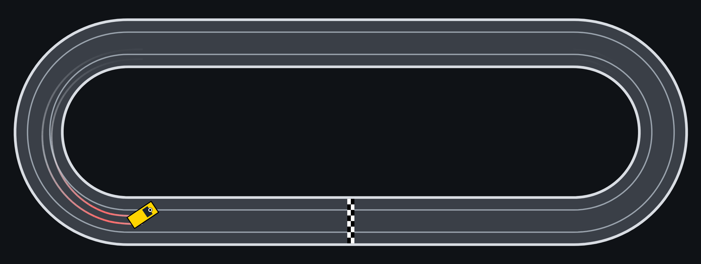
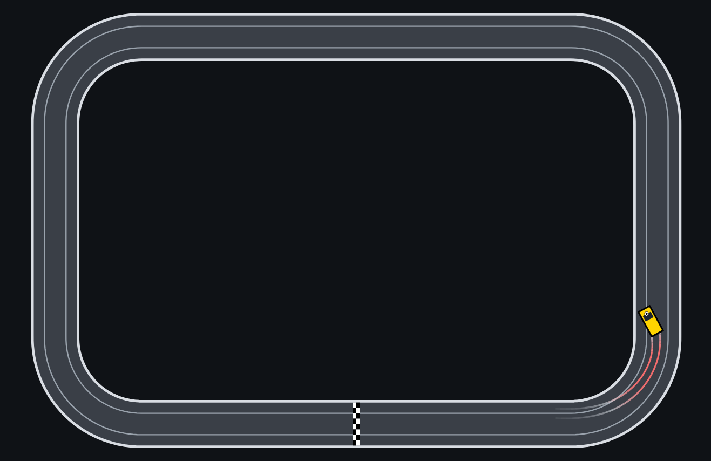
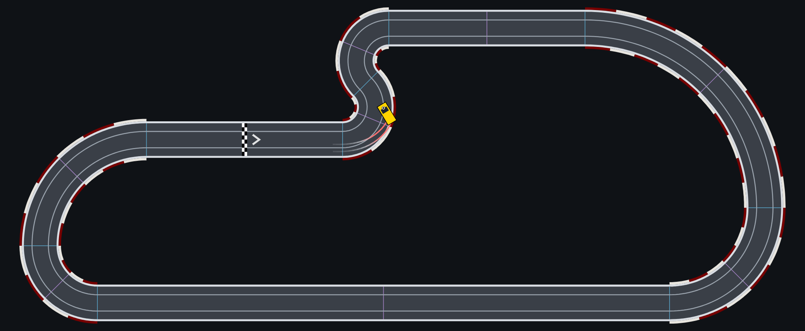
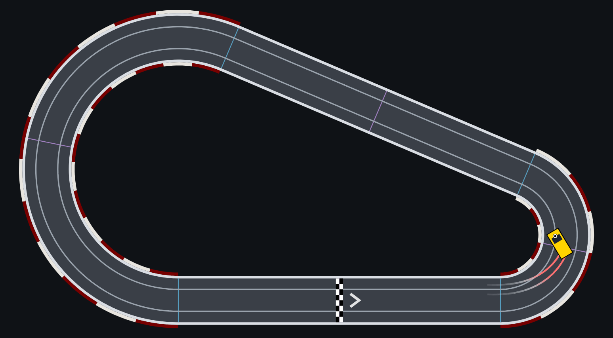
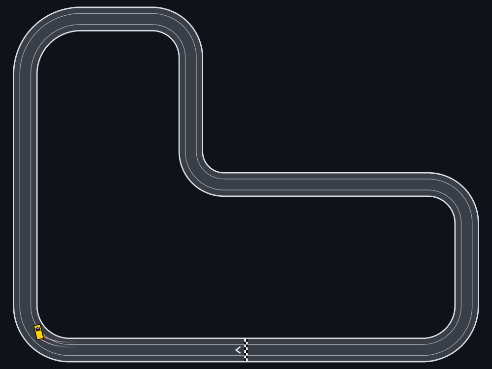
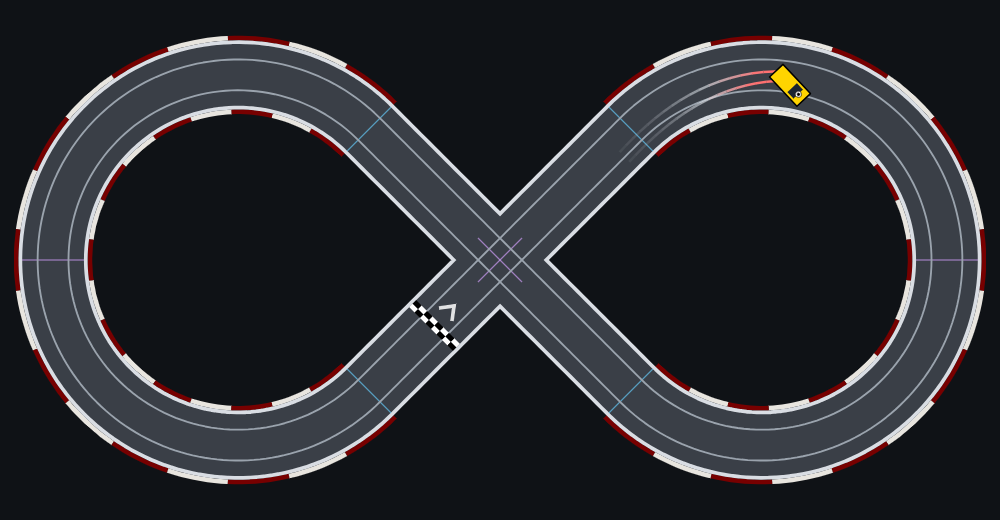

# The circuits

There are six circuits. The car runs on the lane named inner, and the length given is that of one lap. On Infinite Loop, each lane alternates between the inside and outside of the two lobes. Each picture shows the car in a slide, with its tire marks behind it.

## Oval

Two straights joined by two half circles: the plainest circuit, and the one the game opens on. A lap is 6.20 m long.

## Speedway

A rounded rectangle: four corners instead of two half circles, and two short side straights. A lap is 8.20 m long.

## Chicane

A circuit driven clockwise. An S-bend of two tight curves on the first straight, then a half turn that starts wide and tightens, a long straight and a half turn that starts tight and widens. A lap is 10.74 m long.

## Teardrop

A wide curve at one end and a tight hairpin at the other, joined by two straights. A lap is 5.57 m long.

## Club

The longest circuit. A rounded L driven clockwise, with a wide first curve, five right turns of different radii and a left turn in the inside corner. A lap is 11.16 m long.

## Infinite Loop

A horizontal eight with two round lobes joined by diagonals crossing at ground level. The right lobe runs clockwise and the left counterclockwise; both lanes have the same length. A lap is 8.05 m long.

[Back to the README](../README.md)
